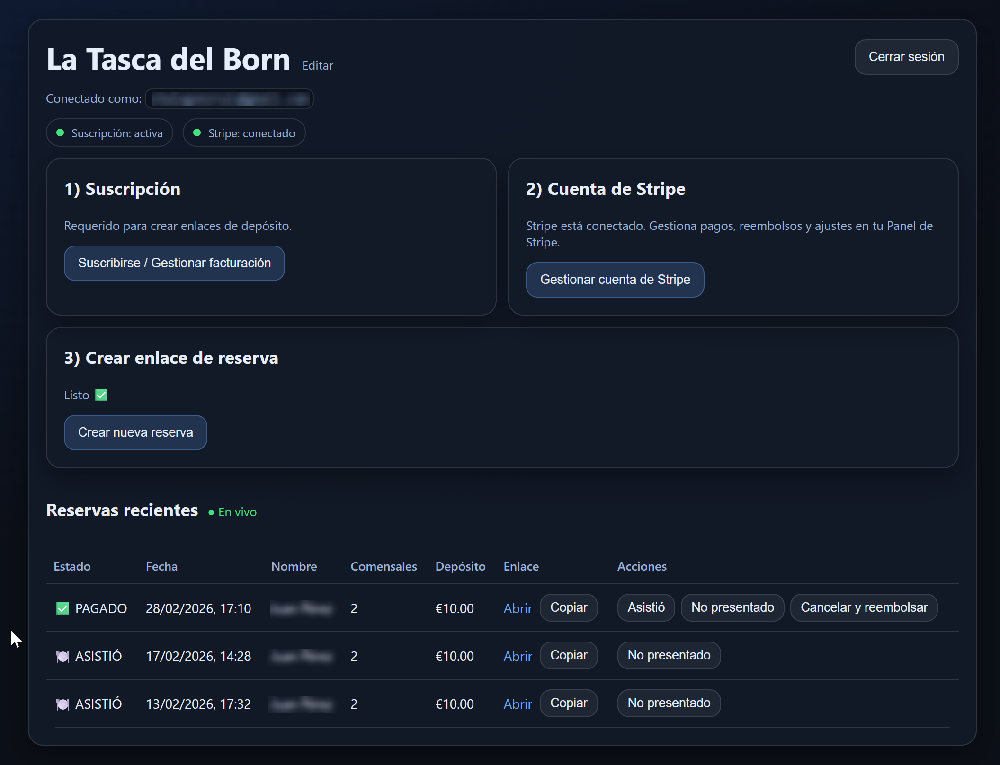
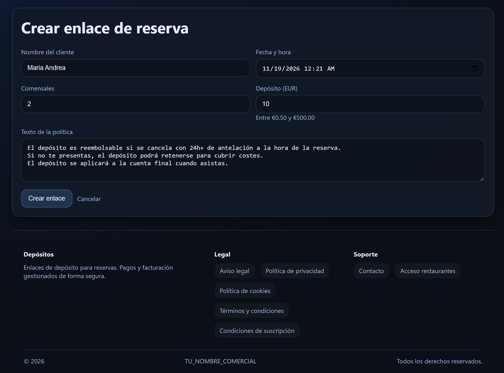
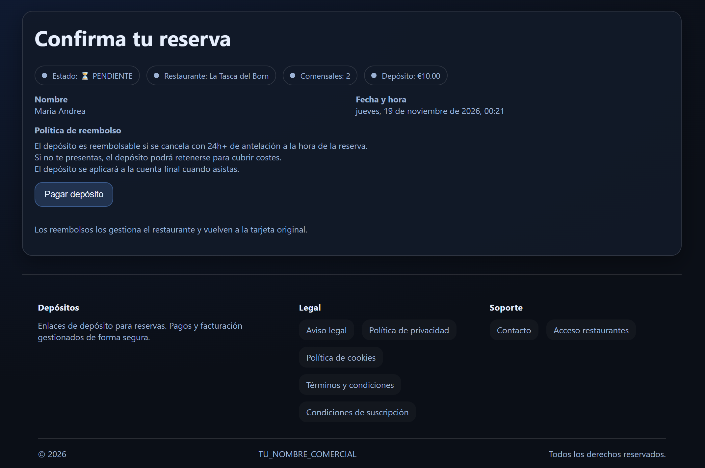
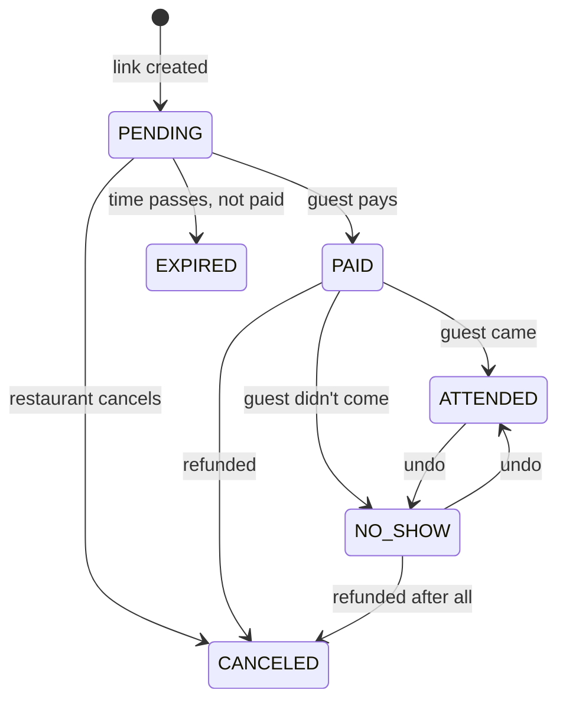
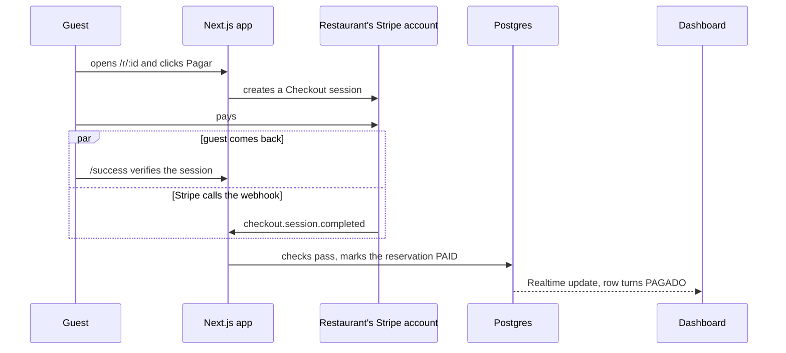

# Deposit Links

A small SaaS I built for restaurants in Spain that are tired of no-shows.

The restaurant creates a reservation and sends the guest a link, usually over WhatsApp.
The guest pays a deposit by card, and the reservation shows up as paid on the
restaurant's dashboard right away, without refreshing. When the guest turns up, the
deposit comes off the bill. If they don't, the restaurant keeps it. If the restaurant
has to cancel, one click refunds it.

Restaurants pay a monthly subscription to use it. Guest deposits never go through the
platform's account: they land directly in each restaurant's own Stripe account via
Stripe Connect.

[](https://github.com/chalogr2/DepositsApp/actions/workflows/ci.yml)



| Creating a link | Link ready to send | What the guest sees |
|---|---|---|
|  |  |  |

## Built with

Next.js 14 (App Router) and TypeScript, Supabase (Postgres, Auth, Realtime and row level
security), Stripe (Billing, Checkout, Connect Express and webhooks), zod, Vitest and
GitHub Actions.

## How a reservation works



Unpaid links stop working at the reservation time. "Attended" and "no-show" can only be
set once that time has passed.

## Things I had to get right

Most of the work here wasn't the screens. It was making sure money and reservation state
never drift apart. These are the problems that took the most thought. Each one is written
up in more detail in [DEVLOG.md](DEVLOG.md), including how I tested it.

**The browser can only read.** Supabase makes it easy to let the client write straight to
the database, and that's how this started. Then I wrote a script that logged in as a
normal user with only the public key and tried to cheat: insert a reservation already
marked as paid, flip a pending one to paid, create rows for another user. Several of
those worked. Now the client has no write permissions at all, and every change goes
through an API route that checks who you are and what you're allowed to touch. The same
script gets "permission denied" on everything.

**One payment confirms one reservation.** Payments are confirmed in a single function.
It used to trust the reservation id from the URL, so you could pay a €1 reservation and
use that session to confirm a €50 one. Now it takes the reservation from the Stripe
session itself and checks the restaurant's Stripe account, the amount and the currency
before marking anything as paid.

**Closing the tab can't lose a payment.** If a guest paid and closed the tab before the
success page loaded, the reservation stayed pending forever. Now a Stripe Connect
webhook confirms the payment as well. Either path can do it, and running both is
harmless because the update only moves a reservation from pending to paid once.

**Webhooks show up late.** After paying for a subscription, the dashboard kept showing
the old status until you refreshed, because the webhook hadn't arrived yet. The dashboard
now syncs from the Checkout session as soon as you come back, and the sync always
re-reads the subscription from Stripe instead of trusting what an event says.

**Refunds you can click twice.** Cancelling a paid reservation refunds it in Stripe
first and only then updates the database, using one idempotency key per reservation. A
double click, or a retry after an error, gets the same refund back instead of a second
one. Refunds made directly in the Stripe dashboard come in through the webhook too.

**Expiring links without a cron job.** There's no background worker. A pending
reservation whose time has passed is shown as expired straight away, and the database
catches up the next time the server touches that row. That update only applies to rows
that are still pending, so it can't overwrite a payment arriving at the same moment.

**Time zones.** Everything is stored in UTC and shown in Madrid time. Before that, times
were off by an hour or two depending on whether the code ran on the server or in the
browser, and on the time of year.

## How a payment gets confirmed



## Project layout

```
app/
  vendor/                  restaurant dashboard, onboarding, new reservation
  r/[id]/                  page the guest opens
  success/                 where the guest lands after paying
  admin/                   overview of all restaurants
  api/vendor/              restaurant actions
  api/guest/               guest checkout and verification
  api/stripe/              platform webhook and Connect webhook
lib/
  reservation-payments.ts  the only place a reservation becomes paid
  reservation-lifecycle.ts cancel, refund, attended, no-show, expiry
  reservation-status.ts    the status rules, shared by the UI and the API
  billing-sync.ts          copies subscription state from Stripe
migrations/                SQL changes for an existing database, in order
supabase.sql               full schema for a new database
tests/                     Vitest tests
DEVLOG.md                  what changed, why, and how I checked it
```

## Tests

`npm test` runs the Vitest suite. I focused on the places where a bug would cost someone
money: the payment checks (replayed sessions, wrong account, wrong amount, confirming
twice), the reservation rules down to the exact second, the subscription rule and the
time zone handling. The payment tests run against a small in-memory stand-in for the
database, so they don't need Supabase or Stripe. CI runs type checking, lint and the
tests on every push.

## Running it locally

You'll need Node 18 or newer, a Supabase project, a Stripe account in test mode and the
[Stripe CLI](https://stripe.com/docs/stripe-cli).

```bash
npm install
cp .env.example .env
```

Fill in `.env`; each value is explained in the file. Then:

1. In Supabase, run `supabase.sql` in the SQL editor. If the database already exists,
   run whichever files in `migrations/` you haven't run yet, in order. Enable the Email
   provider and add `http://localhost:3000/auth/callback` as a redirect URL.
2. In Stripe, create a monthly recurring price, put its id in `STRIPE_SUB_PRICE_ID` and
   enable Connect with Express accounts.
3. In a second terminal, forward the webhooks and leave it running:
   ```bash
   stripe listen --forward-to localhost:3000/api/stripe/webhook \
                 --forward-connect-to localhost:3000/api/stripe/connect-webhook
   ```
   Copy the `whsec_...` secret it prints into `STRIPE_WEBHOOK_SECRET`.
4. Start the app with `npm run dev` and open http://localhost:3000.

The test card `4242 4242 4242 4242` works with any future date and any CVC.

## Status

This is a portfolio project. It works end to end in Stripe test mode, but it hasn't been
taken to production. That would still need live keys and webhook endpoints, a proper
email provider (or OAuth) for login, IVA on the subscription invoices, email
notifications and some error monitoring. The full backlog is at the end of
[DEVLOG.md](DEVLOG.md).

## License

All rights reserved. The code is public so people can read it, not to be reused. See
[LICENSE](LICENSE).
