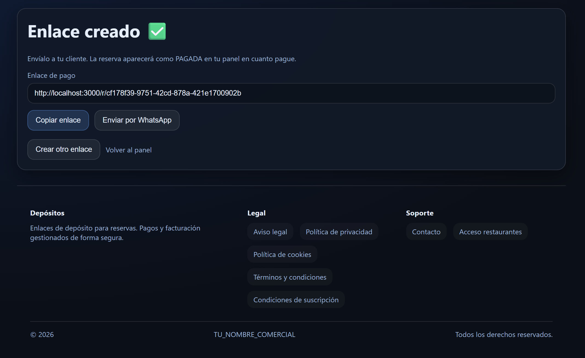
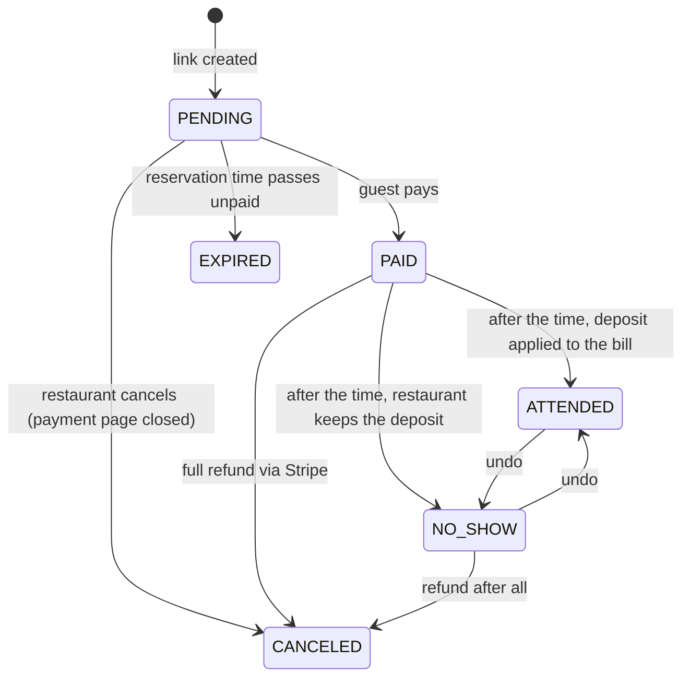
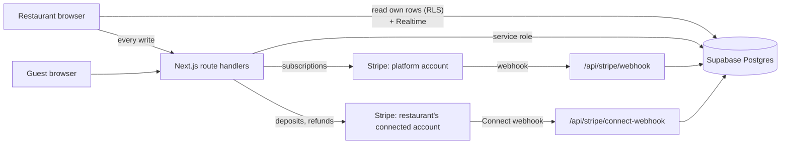
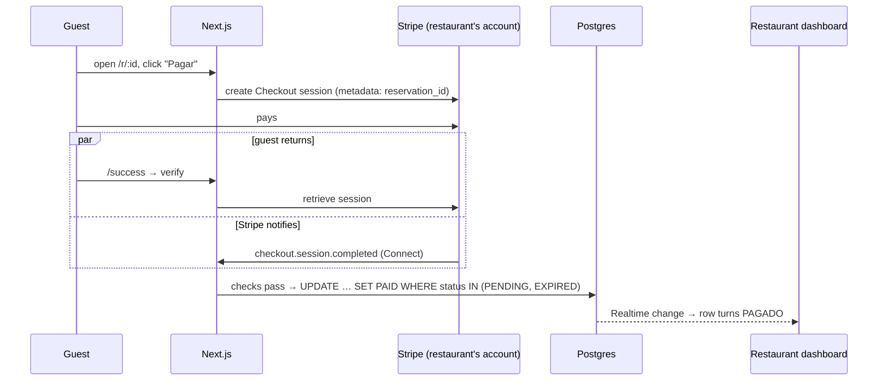

# Deposit Links

**Reservation deposits for restaurants, through a link.** No-shows cost restaurants
real money. With Deposit Links the restaurant creates a reservation, sends the
guest a payment link by WhatsApp, and watches it turn **PAGADO** on its dashboard
in real time. After the meal the deposit is applied to the bill. If the guest doesn't
show, the restaurant keeps it, and if the restaurant cancels, it's refunded with one click.

[](https://github.com/chalogr2/DepositsApp/actions/workflows/ci.yml)


| 1. Restaurant creates the link | 2. Ready to send by WhatsApp |
|---|---|
|  |  |
| **3. Guest opens it and pays** | **4. The dashboard updates live** |
|  | The row turns **PAGADO** without a reload. After the reservation time: *Asistió* / *No presentado*, or *Cancelar y reembolsar*. |

---

## What it does

**The business model.** Restaurants pay the platform a monthly subscription
(Stripe Billing). Guest deposits are charged **directly on each restaurant's own
Stripe account** (Stripe Connect), so the restaurant is the merchant of record
and the platform never holds guest money.

| Restaurant | Guest |
|---|---|
| Passwordless login (magic link) | Opens a link, no account needed |
| Subscribes and manages billing (invoices with address + NIF/CIF) | Sees restaurant, date (Madrid time), party size, deposit, policy |
| Connects their own Stripe account (Express onboarding) | Pays on Stripe Checkout |
| Creates a deposit link, copies it or sends it by WhatsApp | Sees the outcome later: paid, cancelled + refunded, or expired |
| Live reservations table, no reload needed | |
| Per reservation: **Asistió**, **No presentado**, **Cancelar y reembolsar** | |

A reservation moves through a small, explicit state machine:



---

## Engineering highlights

The interesting part of this project is the payment problems it handles, not the CRUD.
Each one is written up in [`DEVLOG.md`](DEVLOG.md): symptom, investigation, root
cause, fix and verification.

- **The browser can only read.** Row Level Security lets an owner read only their own
  rows, and the browser roles have **no** insert/update/delete privileges at all.
  Every write goes through a server route that checks login, ownership,
  subscription and input (zod). I proved this with an attack script that uses
  only the public key, before and after the lockdown.
- **A payment can't be replayed against another reservation.** A reservation becomes
  PAID in exactly one function, which checks the Stripe session against the
  reservation id, the restaurant's connected account, the amount and the currency.
  Earlier, paying €1 for one reservation could confirm a €50 one.
- **No lost payments.** Payments are confirmed twice, independently: by the
  guest's return to `/success`, and by a Stripe **Connect webhook** in case the guest
  closes the tab. Both paths are idempotent, and the database updates are
  conditional (`PENDING → PAID` only), so they can't overwrite each other.
- **Webhooks arrive out of order, so state is re-fetched.** Subscription sync never trusts
  an event payload; it re-reads the subscription from Stripe. After a restaurant pays,
  the dashboard also syncs straight from the Checkout session, so it no longer shows the
  old status while waiting for the webhook.
- **Refunds are safe to retry.** The refund is created before the database
  is updated, with an idempotency key per reservation. A double click or a retry
  returns the same refund instead of refunding twice. Refunds made in the Stripe
  Dashboard are picked up by the webhook too.
- **Expiry without a cron job.** Unpaid links expire at the reservation time. The
  UI computes an *effective status*, and the server writes `EXPIRED` the next time it
  touches the row (conditionally, so a payment landing at that moment is never lost).
- **Live dashboard.** Supabase Realtime pushes changes, still filtered by RLS, and the
  dashboard re-fetches on reconnect and when the tab regains focus, so it catches anything missed.
- **Time zones.** Times are stored in UTC and always shown in `Europe/Madrid`. That fixed
  a 1–2 hour drift between the server (UTC), the browser and the form defaults.
- **One rule, one place.** The UI and the API share pure helpers
  (`lib/reservation-status.ts`, `lib/subscription.ts`, `lib/config.ts`), so a hidden
  button and a refused API call always agree. Both are enforced on the server.

---

## Architecture



How a guest payment is confirmed:



**Stack:** Next.js 14 (App Router, route handlers, middleware) · TypeScript (strict) ·
Supabase (Auth, Postgres, RLS, Realtime) · Stripe (Billing, Checkout, Billing
Portal, Connect Express, webhooks) · zod · Vitest · GitHub Actions

---

## Project structure

```
app/
  vendor/                     restaurant dashboard, onboarding, profile, new reservation
  r/[id]/                     guest deposit page
  success/                    guest return page (verifies the payment)
  admin/                      platform overview (ADMIN_EMAILS only)
  api/vendor/…                restaurant actions: subscribe, connect, create, change status
  api/guest/…                 guest checkout + verify
  api/stripe/webhook          platform events (subscriptions)
  api/stripe/connect-webhook  connected-account events (deposits, refunds)
lib/
  reservation-payments.ts     the only place a reservation becomes PAID
  reservation-lifecycle.ts    cancel/refund, no-show, attended, expiry (server)
  reservation-status.ts       state machine rules (shared by UI + API)
  billing-sync.ts             Stripe → DB subscription sync
  subscription.ts, datetime.ts, money.ts, config.ts
migrations/                   incremental SQL for an existing database, run in order
supabase.sql                  full schema for a new database (= all migrations)
tests/                        Vitest unit tests
DEVLOG.md                     engineering log: every change, why, and how it was verified
```

---

## Tests

```bash
npm test          # Vitest
npm run typecheck
npm run lint
```

CI runs all three on every push and pull request. The tests cover the parts
where a bug costs money or trust:

- **Payment confirmation** (`reservation-payments.test.ts`): replayed sessions,
  the wrong Stripe account, wrong amount or currency, unpaid sessions, idempotency, and
  late payments on expired or cancelled reservations. It runs against an in-memory
  database fake, so no network is needed.
- **Reservation state machine**: every status × before/after the reservation time,
  including the exact-second boundary.
- **Subscription rule**: including the "DB says active but the period is over" case.
- **Time zones and money parsing**: Madrid winter/summer offsets, and `10,50` with a decimal comma.

---

## Running locally

**You need:** Node 18+, a Supabase project, a Stripe account in **test mode** and the
[Stripe CLI](https://stripe.com/docs/stripe-cli).

1. **Install and configure**
   ```bash
   npm install
   cp .env.example .env     # fill in the values; each one is commented in the file
   ```
2. **Database (Supabase)**
   - New project: run `supabase.sql` in the SQL Editor.
   - Existing project: run the `migrations/` files you haven't run yet, in order.
   - Auth → Providers: enable **Email**. Auth → URL Configuration: add
     `http://localhost:3000/auth/callback` as a redirect URL.
3. **Stripe (test mode)**
   - Create a recurring monthly Price and put its id in `STRIPE_SUB_PRICE_ID`.
   - Enable **Connect** (Express accounts).
4. **Forward webhooks** in a second terminal, and leave it running:
   ```bash
   stripe login
   stripe listen --forward-to localhost:3000/api/stripe/webhook \
                 --forward-connect-to localhost:3000/api/stripe/connect-webhook
   ```
   Put the printed `whsec_…` in `STRIPE_WEBHOOK_SECRET`. Locally one secret
   signs both endpoints, so leave `STRIPE_CONNECT_WEBHOOK_SECRET` empty.
5. **Run**
   ```bash
   npm run dev              # http://localhost:3000
   ```
   Test card: `4242 4242 4242 4242`, any future date, any CVC.

---

## Status and roadmap

A working MVP, built as a portfolio project and run in Stripe test mode.
Before real use it would need:

- production setup: live keys, production webhook endpoints, custom SMTP or OAuth login;
- IVA on subscription invoices (Stripe Tax);
- email notifications, plus pagination and search on the dashboard;
- error monitoring.

The full backlog, with priorities, is at the end of [`DEVLOG.md`](DEVLOG.md).
